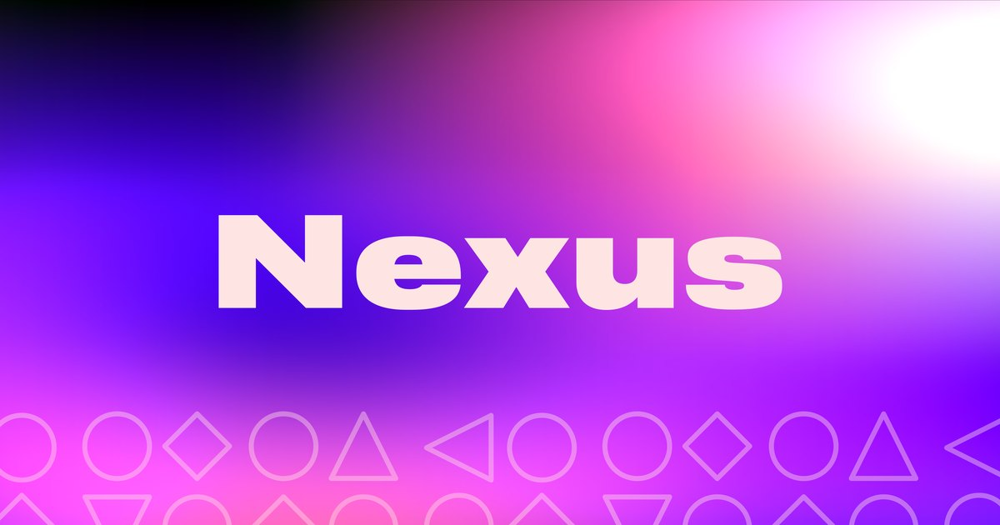

<p align="center">
  
</p>

# nexus-site

Sitio de Nexus: software con foco en diseño, AI y productividad. Landing de una página construida con el design system Nexus.

## Stack

Bun · Vite · React 19 · TypeScript · Tailwind CSS v4 · Motion · lucide-react · OxLint · OxFmt

## Desarrollo

```sh
bun install
bun run dev       # http://localhost:5173
bun run build     # type-check + build a dist/
bun run preview   # sirve dist/
bun run lint      # oxlint
bun run fmt       # oxfmt
```

## Deploy

Cada push a `main` publica en `nexus.wefaber.net` (VPS, nginx, runner `vps-nexus`). El producto vive en `app.nexus.wefaber.net`. Detalle y runbook de la mudanza: [`deploy/README.md`](deploy/README.md).

## Estructura

```text
design/tokens.json                 Tokens del design system (fuente)
scripts/build-tokens.ts            Genera src/styles/tokens.css (bun run tokens)
src/styles/tokens.css              Variables CSS por tema (light / dark / prefers-color-scheme)
src/styles/nexus-components.css    Estilos de los componentes (prefijo nx-)
src/styles/app.css                 Tailwind v4 + puente tokens → utilidades
src/components/ui/nexus.tsx        Componentes: Button, Input, Checkbox, Switch, Badge, Card, Avatar, Tabs, Alert, Tooltip, Kbd
src/content.ts                     Todo el texto del sitio
src/sections/                      Header, Hero, Pillars, Projects, System, Principles, Closing
deploy/                            Script de deploy, configs de nginx y runbook
public/                            Isotipo, banner, patterns, favicon y Open Graph
```

## Design system

Los tokens y componentes vienen del design system Nexus. Para actualizar:

1. Copiá el `tokens.json` nuevo a `design/tokens.json` y corré `bun run tokens`.
2. Copiá `components/src/index.tsx` a `src/components/ui/nexus.tsx` y `components/bundle.css` a `src/styles/nexus-components.css` (sin el `@import` de fuentes ni las reglas `body` / `.nx-demo*`, que el sitio ya define).

Reglas que el sitio respeta:

- Un solo botón `primary` por vista.
- El gradiente de marca solo en piezas de marca (banner, Open Graph); la UI usa planos sólidos.
- `pink-400` es decorativo, nunca texto.
- Texto interactivo en `link`, no en `primary` (contraste en dark).
- Animaciones con Motion, desactivadas con `prefers-reduced-motion`.
